<div align="center">

# 📚 Study Library Management System (SLMS)

**A modern, production-grade library seat reservation and administration platform designed for seamless library operations, real-time seat allocations, and role-based workflows.**

---

[](https://www.python.org/)
[](https://flask.palletsprojects.com/)
[](https://vuejs.org/)
[](https://www.sqlalchemy.org/)
[]()
[]()

</div>

---

## 📖 Table of Contents

- [Overview](#-overview)
- [System Architecture & Roles](#-system-architecture--roles)
  - [👑 Administrator Portal](#-administrator-portal)
  - [🧑‍💼 Staff Portal](#-staff-portal)
  - [🎓 Student Portal](#-student-portal)
- [Tech Stack](#-tech-stack)
- [Quick Start & Setup Guide](#-quick-start--setup-guide)
  - [Prerequisites](#prerequisites)
  - [1. Clone / Navigate to Repository](#1-clone--navigate-to-repository)
  - [2. Environment Setup](#2-environment-setup)
    - [Windows (PowerShell)](#windows-powershell)
    - [Windows (Command Prompt)](#windows-command-prompt)
    - [macOS & Linux (Bash / Zsh)](#macos--linux-bash--zsh)
  - [3. Configure Environment Variables](#3-configure-environment-variables)
  - [4. Run the Application](#4-run-the-application)
- [Default Seed Credentials](#-default-seed-credentials)
- [Project Structure](#-project-structure)
- [API Reference](#-api-reference)
- [Milestones & Project Deliverables](#-milestones--project-deliverables)
- [Running Automated Tests](#-running-automated-tests)
- [Production Deployment](#-production-deployment)
- [Team Members & Contributors](#-team-members--contributors)
- [License](#-license)

---

## 🌟 Overview

The **Study Library Management System (SLMS)** provides an end-to-end management ecosystem for study libraries, reading rooms, and co-working study spaces. It eliminates manual physical registers by offering real-time seat reservation, automated attendance & check-in verification, membership subscriptions, complaint ticketing, offline payment logging, and actionable administrative analytics.

---

## 👥 System Architecture & Roles

```mermaid
graph TD
    classDef system fill:#2563eb,stroke:#1d4ed8,stroke-width:2px,color:#ffffff,font-weight:bold;
    classDef admin fill:#7c3aed,stroke:#6d28d9,stroke-width:2px,color:#ffffff,font-weight:bold;
    classDef staff fill:#059669,stroke:#047857,stroke-width:2px,color:#ffffff,font-weight:bold;
    classDef student fill:#d97706,stroke:#b45309,stroke-width:2px,color:#ffffff,font-weight:bold;

    SYS["📚 Study Library Management System"]:::system

    SYS --> ADM["👑 Administrator Portal"]:::admin
    SYS --> STF["🧑‍💼 Staff Operations Portal"]:::staff
    SYS --> STU["🎓 Student Booking Portal"]:::student

    subgraph Admin_Portal["Administrator Capabilities"]
        direction TB
        A1["Staff Accounts & Access Controls"]
        A2["Membership Plans & Pricing"]
        A3["Membership Verification & Approvals"]
        A4["Operating Hours & Holiday Closures"]
        A5["Capacity, Seat Zones & Booking Rules"]
        A6["Analytics: Occupancy, Revenue & Peaks"]
        A7["Announcement Broadcasting"]
    end

    subgraph Staff_Portal["Staff Operations"]
        direction TB
        S1["Daily Roster & Schedule Verification"]
        S2["Walk-In Same-Day Seat Allocation"]
        S3["Study Time Extension Approvals"]
        S4["Offline / Cash Fee Payment Logging"]
        S5["New Student Registration & Onboarding"]
        S6["Membership ID Verification"]
        S7["Student Complaint Resolution Helpdesk"]
    end

    subgraph Student_Portal["Student Services"]
        direction TB
        U1["Live Interactive Seat Availability Map"]
        U2["Multi-Slot Seat Reservation"]
        U3["Active Bookings & Self Check-Out"]
        U4["Study Session History & Hours Logged"]
        U5["Membership Subscriptions & Invoices"]
        U6["Issue & Complaint Ticket Lodging"]
    end

    ADM --- Admin_Portal
    STF --- Staff_Portal
    STU --- Student_Portal
```



### 👑 Administrator Portal
- **Staff Accounts**: Create, edit, activate, or deactivate library staff accounts.
- **Membership Approvals**: Review pending student registrations with instant Approve, Reject, or Suspend actions.
- **Operating Hours**: Configure weekly schedules (Monday–Sunday) and holiday closure dates.
- **Capacity & Limits**: Adjust maximum booking hours per day, concurrent seat allocations, waitlist rules, and zone definitions (Quiet, Discussion, Computer Lab).
- **Plans & Pricing**: Create and manage flexible membership tiers (Weekly, Monthly, Yearly, Custom).
- **Analytics & Reports**: Visual charts for occupancy rates, peak study hours, revenue streams, and membership distribution.
- **Broadcasts**: Publish library announcements targeted to All, Staff, or Students.

### 🧑‍💼 Staff Portal
- **Check-In & Attendance**: Verify student reservations via check-in codes or manual roster lookups.
- **Walk-in Allocations**: Instantly allocate available seats to same-day walk-in students.
- **Extension Requests**: Review and approve student requests for extra study hours.
- **Fee Management**: Log cash/offline payment receipts against student accounts.
- **Student Onboarding**: Register new student profiles and assign membership plans.
- **Complaint Helpdesk**: Review student-reported issues, add resolution notes, and update ticket statuses.

### 🎓 Student Portal
- **Interactive Space Booking**: Filter by date, time slot (Morning, Afternoon, Evening, Full Day), and seat zones.
- **Live Seat Availability**: View real-time seat availability matrix.
- **My Bookings**: View active reservations, copy check-in codes, request time extensions, cancel reservations, or perform self check-out.
- **Session History**: Track total logged study hours and past attendance records.
- **Fee Receipts**: Review active membership validity and payment transaction history.
- **Help & Complaints**: Submit tickets categorized by AC/Temperature, Noise, Wi-Fi, Seat Damage, or Other.

---

## 🛠 Tech Stack

- **Backend**: Python 3.10+, Flask 3.1, Flask-RESTful, Flask-JWT-Extended, Werkzeug Security
- **Database & ORM**: SQLAlchemy 2.0, SQLite (default) / PostgreSQL / MySQL ready
- **Frontend**: Vue 3 (Reactive Composition Engine), Vanilla CSS with custom glassmorphism design tokens
- **WSGI & Dev Servers**: Werkzeug, Waitress WSGI
- **Testing & QA**: Pytest, Playwright Browser Automation

---

## 🚀 Quick Start & Setup Guide

### Prerequisites
- **Python 3.10 or higher** installed ([Download Python](https://www.python.org/downloads/))
- **Git** installed ([Download Git](https://git-scm.com/))

---

### 1. Clone / Navigate to Repository

```bash
git clone https://github.com/GyaanFlow/MAY2026-Team-051.git
cd MAY2026-Team-051
```

---

### 2. Environment Setup

#### Windows (PowerShell)
```powershell
# Create virtual environment
python -m venv venv

# Activate virtual environment
.\venv\Scripts\Activate.ps1

# Upgrade pip and install dependencies
python -m pip install --upgrade pip
pip install -r requirements.txt
```

#### Windows (Command Prompt)
```cmd
:: Create virtual environment
python -m venv venv

:: Activate virtual environment
venv\Scripts\activate.bat

:: Upgrade pip and install dependencies
python -m pip install --upgrade pip
pip install -r requirements.txt
```

#### macOS & Linux (Bash / Zsh)
```bash
# Create virtual environment
python3 -m venv venv

# Activate virtual environment
source venv/bin/activate

# Upgrade pip and install dependencies
python3 -m pip install --upgrade pip
pip install -r requirements.txt
```

---

### 3. Configure Environment Variables

Create your local `.env` configuration file from the template:

**Windows (PowerShell):**
```powershell
Copy-Item .env.example .env
```

**macOS / Linux:**
```bash
cp .env.example .env
```

Default configuration in `.env`:
```ini
FLASK_ENV=development
SECRET_KEY=dev-secret-key-change-in-production
JWT_SECRET_KEY=jwt-secret-key-change-in-production
DATABASE_URL=sqlite:///instance/app.db
JWT_ACCESS_TOKEN_EXPIRES_HOURS=8
CORS_ORIGINS=*
HOST=127.0.0.1
PORT=5000
```

---

### 4. Run the Application

Execute the application runner (the database and seed data will initialize automatically on first startup):

```bash
python app.py
```

The application will be live at:
👉 **`http://127.0.0.1:5000`**

---

## 🔑 Default Seed Credentials

When starting the application for the first time, default seed data is automatically populated:

| Role | Username | Password | Access URL |
| :--- | :--- | :--- | :--- |
| **👑 Admin** | `admin` | `test-password` | `http://127.0.0.1:5000/` $\rightarrow$ `/admin/dashboard` |

> [!TIP]
> - **Staff Accounts**: Log in as `admin`, navigate to **Staff Account Management**, and click **Create Staff Account**.
> - **Student Accounts**: Log in as `staff`, navigate to **Create Student Account**, and register the student. Then log back in as `admin` under **Student Membership Management** to approve their membership.

---

## 📂 Project Structure

```text
├── app.py                     # Application factory, route registrations & seed initializer
├── config.py                  # Environment settings, JWT & database configurations
├── models.py                  # SQLAlchemy database models (Users, Students, Seats, Bookings, Plans, etc.)
├── utils.py                   # Role-based decorators and helper utilities
├── requirements.txt           # Production & development dependencies
├── .env.example               # Environment variables template
├── .gitignore                 # Git ignore rules for Python, IDEs, and environments
│
├── docs/                      # Course deliverables, reports, API specs & diagrams
│   ├── architecture/          # ER diagram, class diagram, Gantt chart, Kanban board
│   ├── milestone-1/           # Requirements, user stories, MoM, consent & honor codes
│   ├── milestone-2/           # Frontend prototype report, UI architecture, ER DBML
│   ├── milestone-3/           # Backend API specs (OpenAPI / Swagger) & report
│   ├── milestone-4/           # Testing suite deliverable, guide & API schemas
│   └── milestone-5/           # Final project report, presentations & user guide
│
├── resources/                 # RESTful API controllers
│   ├── auth.py                # JWT authentication & login controller
│   ├── profile.py             # User profile updates & password resets
│   ├── admin_memberships.py   # Admin membership approvals & suspensions
│   ├── staff.py               # Admin staff account management
│   ├── staff_students.py      # Staff student registration & ID verification
│   ├── membership.py          # Membership plan catalog
│   ├── seats.py               # Seat availability, zoning, and inventory
│   ├── bookings.py            # Seat reservations, checkouts, and walk-ins
│   ├── checkin.py             # Check-in code verification
│   ├── extension_requests.py  # Student study time extension requests
│   ├── no_show.py             # No-show candidate evaluation & seat release
│   ├── payments.py            # Fee payment history & offline receipt recording
│   ├── complaints.py          # Helpdesk & complaint resolution
│   ├── announcements.py       # Global broadcasts & notices
│   ├── reports.py             # Occupancy, revenue, and peak-hours analytics
│   └── settings.py            # Library operating hours & capacity limits
│
├── templates/                 # Jinja2 / HTML templates
│   ├── login.html             # Unified authentication portal
│   ├── admin_dashboard.html   # Administrator workspace
│   ├── staff_dashboard.html   # Library staff operations desk
│   └── dashboard.html         # Student portal & booking interface
│
└── static/                    # Frontend assets
    ├── css/
    │   ├── style.css          # Design system, auth styling & utility classes
    │   └── dashboard.css      # Dashboard layout, sidebar, stat cards & forms
    └── js/
        ├── api.js             # Fetch wrapper with JWT headers & error handling
        ├── auth-guard.js      # Client-side route protection & session guard
        ├── auth.js            # Login form controller
        ├── admin_dashboard.js # Admin SPA controller
        ├── staff_dashboard.js # Staff SPA controller
        ├── dashboard.js       # Student SPA controller
        ├── library-data.js    # Time slot helpers & mock data constants
        └── toast.js           # Toast notification engine
```

---

## 📡 API Reference

### Authentication & Profile
| Method | Endpoint | Access | Description |
| :--- | :--- | :--- | :--- |
| `POST` | `/api/auth/login` | Public | Authenticate user and return JWT access token |
| `GET` | `/api/profile` | Authenticated | Retrieve current user profile |
| `PUT` | `/api/profile` | Authenticated | Update user personal information |
| `POST` | `/api/auth/reset-password` | Authenticated | Change user password |

### Administrator Endpoints
| Method | Endpoint | Access | Description |
| :--- | :--- | :--- | :--- |
| `GET`, `POST` | `/api/admin/staff` | Admin | List staff members / Create staff account |
| `PUT` | `/api/admin/staff/<id>` | Admin | Update staff account details |
| `POST` | `/api/admin/staff/<id>/deactivate` | Admin | Deactivate staff account |
| `POST` | `/api/admin/staff/<id>/activate` | Admin | Activate staff account |
| `GET` | `/api/admin/memberships/pending` | Admin | List pending membership approval requests |
| `POST` | `/api/admin/memberships/<id>/approve` | Admin | Approve student membership |
| `POST` | `/api/admin/memberships/<id>/reject` | Admin | Reject student membership |
| `GET`, `POST` | `/api/admin/membership-plans` | Admin | List / Create membership plans |
| `GET`, `PUT` | `/api/admin/settings` | Admin | Retrieve / Update operating hours & limits |
| `GET` | `/api/admin/reports/occupancy` | Admin | Retrieve occupancy percentage analytics |
| `GET` | `/api/admin/reports/revenue` | Admin | Retrieve revenue report breakdown |
| `GET` | `/api/admin/reports/peak-hours` | Admin | Retrieve peak usage hours data |
| `GET`, `POST` | `/api/admin/announcements` | Admin | View / Publish library announcements |

### Staff Operations Endpoints
| Method | Endpoint | Access | Description |
| :--- | :--- | :--- | :--- |
| `GET` | `/api/staff/bookings/today` | Staff | Retrieve today's booking roster |
| `POST` | `/api/staff/checkin` | Staff | Verify check-in code and check student in |
| `POST` | `/api/staff/bookings/walk-in` | Staff | Allocate seat to walk-in student |
| `POST` | `/api/staff/students/register` | Staff | Register new student profile |
| `GET` | `/api/staff/extension-requests` | Staff | List student extension requests |
| `POST` | `/api/staff/extension-requests/<id>/approve`| Staff | Approve study extension request |
| `POST` | `/api/staff/payments` | Staff | Record manual / offline fee payment |
| `GET`, `PUT` | `/api/staff/complaints/<id>` | Staff | List complaints / Update complaint resolution |

### Student Workspace Endpoints
| Method | Endpoint | Access | Description |
| :--- | :--- | :--- | :--- |
| `GET` | `/api/seats/availability` | Authenticated | Live seat occupancy and availability status |
| `GET`, `POST` | `/api/bookings` | Student | List active bookings / Create new seat reservation |
| `POST` | `/api/bookings/<id>/cancel` | Student | Cancel upcoming seat reservation |
| `POST` | `/api/bookings/<id>/checkout` | Student | Self checkout from current seat |
| `POST` | `/api/students/me/bookings/<id>/extension-request` | Student | Request booking extension |
| `GET` | `/api/students/me/payments` | Student | Retrieve student fee & transaction history |
| `POST` | `/api/students/me/complaints` | Student | Submit complaint or issue ticket |

---

## 📑 Milestones & Project Deliverables

All project milestone submissions, documentation, and architecture artifacts are organized in the [`docs/`](file:///c:/Users/gaura/OneDrive/Desktop/seProject%20Test/MAY2026-Team-051/docs) directory:

### Milestone 1: Requirements Analysis & Project Planning
- **Deliverables**: [Milestone 1 Report (PDF)](file:///c:/Users/gaura/OneDrive/Desktop/seProject%20Test/MAY2026-Team-051/docs/milestone-1/Milestone_1_Deliverables.pdf) | [Word Document](file:///c:/Users/gaura/OneDrive/Desktop/seProject%20Test/MAY2026-Team-051/docs/milestone-1/Milestone_1_Deliverables.docx)
- **Problem Statement & Features**: [Problem & Features](file:///c:/Users/gaura/OneDrive/Desktop/seProject%20Test/MAY2026-Team-051/docs/milestone-1/problem-and-features.txt)
- **User Identification**: [User Personas & Identification](file:///c:/Users/gaura/OneDrive/Desktop/seProject%20Test/MAY2026-Team-051/docs/milestone-1/user-identification.txt)
- **Project Planning**: [Gantt Chart](file:///c:/Users/gaura/OneDrive/Desktop/seProject%20Test/MAY2026-Team-051/docs/milestone-1/gantt-chart.png) | [Kanban Board](file:///c:/Users/gaura/OneDrive/Desktop/seProject%20Test/MAY2026-Team-051/docs/milestone-1/kanban-board.png) | [Sprint Schedule](file:///c:/Users/gaura/OneDrive/Desktop/seProject%20Test/MAY2026-Team-051/docs/milestone-1/sprint-schedule.txt)
- **Meetings & Interviews**: [Minutes of Meetings (MoM)](file:///c:/Users/gaura/OneDrive/Desktop/seProject%20Test/MAY2026-Team-051/docs/milestone-1/minutes-of-meeting) | [Consent & Proofs](file:///c:/Users/gaura/OneDrive/Desktop/seProject%20Test/MAY2026-Team-051/docs/milestone-1/interviews-and-proofs)
- **Team Honor Codes**: [Honor Code Submissions](file:///c:/Users/gaura/OneDrive/Desktop/seProject%20Test/MAY2026-Team-051/docs/milestone-1/honor-code)

### Milestone 2: System Design & Frontend Prototype
- **Deliverables**: [Milestone 2 Report (PDF)](file:///c:/Users/gaura/OneDrive/Desktop/seProject%20Test/MAY2026-Team-051/docs/milestone-2/Milestone-2_report.pdf)
- **Architecture & Design**: [Entity Relationship Diagram](file:///c:/Users/gaura/OneDrive/Desktop/seProject%20Test/MAY2026-Team-051/docs/milestone-2/er.png) | [DBML Schema](file:///c:/Users/gaura/OneDrive/Desktop/seProject%20Test/MAY2026-Team-051/docs/milestone-2/er-dbml.txt)
- **Component Design**: [Class Diagram](file:///c:/Users/gaura/OneDrive/Desktop/seProject%20Test/MAY2026-Team-051/docs/milestone-2/class-diagram.png) | [Component Architecture](file:///c:/Users/gaura/OneDrive/Desktop/seProject%20Test/MAY2026-Team-051/docs/milestone-2/design-of-component.txt)
- **User Stories**: [User Stories Breakdown](file:///c:/Users/gaura/OneDrive/Desktop/seProject%20Test/MAY2026-Team-051/docs/milestone-2/user-stories.txt)

### Milestone 3: Backend API Architecture & Core Endpoints
- **Deliverables**: [Milestone 3 Report (PDF)](file:///c:/Users/gaura/OneDrive/Desktop/seProject%20Test/MAY2026-Team-051/docs/milestone-3/Milestone_3_Deliverables.pdf)
- **API Documentation**: [OpenAPI / Swagger Spec (YAML)](file:///c:/Users/gaura/OneDrive/Desktop/seProject%20Test/MAY2026-Team-051/docs/milestone-3/openapi.swagger.yaml)

### Milestone 4: Comprehensive Backend API & Automated Testing Suite
- **Deliverables**: [Milestone 4 Report (PDF)](file:///c:/Users/gaura/OneDrive/Desktop/seProject%20Test/MAY2026-Team-051/docs/milestone-4/Milestone_4_Deliverables.pdf)
- **API Specification**: [OpenAPI 3.0 Specification (YAML)](file:///c:/Users/gaura/OneDrive/Desktop/seProject%20Test/MAY2026-Team-051/docs/milestone-4/openapi.swagger.yaml)
- **Implementation Guide**: [Backend & Testing Guide](file:///c:/Users/gaura/OneDrive/Desktop/seProject%20Test/MAY2026-Team-051/docs/milestone-4/guide.txt)

### Milestone 5: Full System Integration, Packaging & Final Presentation
- **Final Report**: [Milestone 5 Report (PDF)](file:///c:/Users/gaura/OneDrive/Desktop/seProject%20Test/MAY2026-Team-051/docs/milestone-5/Milestone_5_Report.pdf)
- **Executive Summary & User Manual**: [README (PDF)](file:///c:/Users/gaura/OneDrive/Desktop/seProject%20Test/MAY2026-Team-051/docs/milestone-5/README.pdf)
- **Presentations**: [Brief Presentation (PDF)](file:///c:/Users/gaura/OneDrive/Desktop/seProject%20Test/MAY2026-Team-051/docs/milestone-5/Brief_Presentation.pdf) | [Detailed Presentation (PDF)](file:///c:/Users/gaura/OneDrive/Desktop/seProject%20Test/MAY2026-Team-051/docs/milestone-5/Detailed_Presentation.pdf)

---

## 🧪 Running Automated Tests

The repository includes a comprehensive test suite covering backend logic, JWT security, and API endpoints.

```bash
# Run all unit and integration tests
pytest

# Run tests with verbose output
pytest -v

# Run with coverage summary
pytest --cov=.
```

---

## 🚢 Production Deployment

For production environments, run behind a production WSGI server such as **Waitress** (Windows / Cross-platform) or **Gunicorn** (Linux / macOS):

### Using Waitress (Windows / Linux / macOS)
```bash
waitress-serve --listen=0.0.0.0:5000 app:create_app
```

### Using Gunicorn (Linux / macOS)
```bash
gunicorn -w 4 -b 0.0.0.0:5000 "app:create_app()"
```

---

## 👥 Team Members & Contributors

**Team MAY2026-Team-051**

| Roll Number | Name | Contribution & Role |
| :--- | :--- | :--- |
| `23f1000805` | Gaurav Tomar | Lead Developer & System Integration |
| `23f1000033` | Karthik V N | Backend Architecture & API Development |
| `23f1001878` | Akshatha A | UI/UX & Frontend Development |
| `23f2004899` | Diksha Sharma | Quality Assurance & Testing Suite |
| `24f1002416` | Neha Chacko | Requirements Analysis & Documentation |

---

## 📄 License

This project is licensed under the MIT License — see the repository for details.